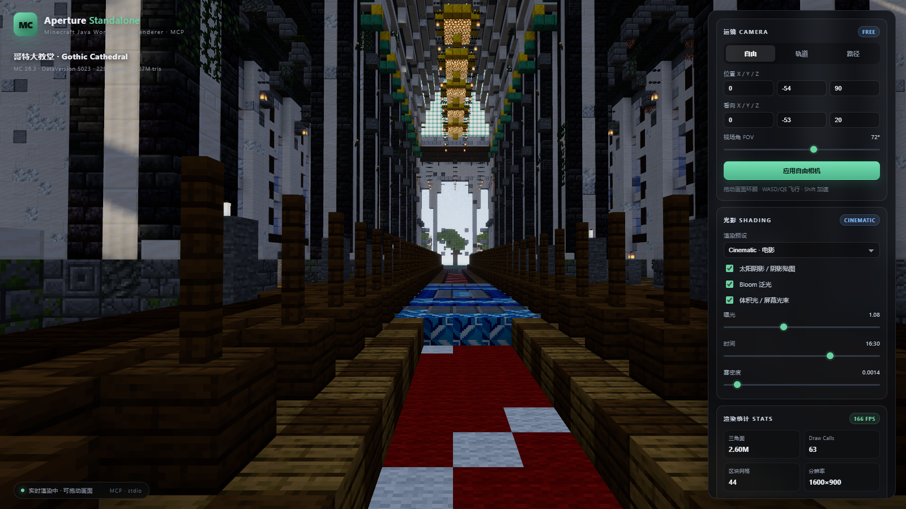
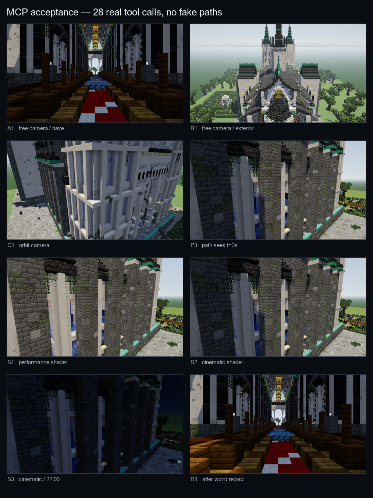
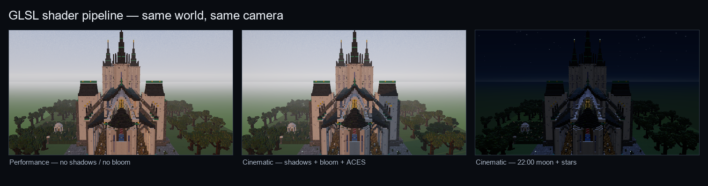

# Aperture — 不依赖 Minecraft 客户端的 Java 存档实时渲染 / 运镜 MCP

一个**独立运行**的 Minecraft Java 存档渲染器：直接读取 `level.dat` + Anvil region 文件，在 Node 里编译 NBT、方块模型和纹理，在浏览器里用 WebGL2 / Three.js 做 GPU 实时渲染。运行时**不启动 Minecraft、不依赖 Mod、不读取客户端进程**，通过 MCP 把渲染、相机、方块查询和截图能力交给 AI Agent。



本次验收使用的测试存档是 `testdata/gothic-cathedral`（Minecraft 26.3，DataVersion 5023，哥特大教堂）。渲染器加载 2.27M 三角面，44 个静态批次，60 余个 draw call；独立 GPU 截图与相机元数据均可复现。



---

## 1. 验收结果（本次真实运行）

运行：

```powershell
npm run acceptance
```

验收脚本会通过 **MCP stdio 协议**启动 `src/mcp-server.js`，然后**只通过 MCP 工具调用**完成加载、查询、相机、路径、光影切换、截图、重载和性能测试；不会直接调用渲染器内部 API，也不会伪造截图。

本次结果（`acceptance/out/report.json`）：

| 检查 | 结果 |
|---|---|
| MCP 工具列表完整 | PASS |
| 未加载世界时返回结构化错误 `NOT_LOADED` | PASS |
| 不存在的存档返回结构化错误 `WORLD_NOT_FOUND` | PASS |
| 测试存档加载（225 chunks，2,268,436 tris，44 meshes） | PASS |
| 世界信息 / 方块查询 / 方块搜索 | PASS |
| 相机截图与相机矩阵元数据 | PASS |
| 同一相机连续截图稳定性 | PASS（meanAbs = 0） |
| 调整相机后画面明显变化 | PASS（meanAbs = 111.3，99.9% 像素变化） |
| 轨道相机 | PASS |
| 路径关键帧 seek 到不同时间点 | PASS |
| performance / cinematic 光影切换 | PASS |
| 22:00 夜间光照与星空 | PASS |
| 世界重载并再次截图 | PASS |
| benchmark > 60 FPS @ 1280×720 | PASS（本次 glFinish 合成基准 1,944 FPS；实时 RAF 约 100–135 FPS） |

同相机截图稳定性对比（连续两次 `mc_screenshot`）：

```
meanAbs = 0, changedFraction = 0
```

相机 A（中殿）→ 相机 B（大教堂外观）：

```
meanAbs = 111.3, changedFraction = 0.9989
```

> 说明：`mc_benchmark` 是连续提交帧并 `glFinish` 的合成吞吐测试，数值高于浏览器实时 RAF；两个数字都会在 `mc_render_stats` / `mc_benchmark` 中返回。

---

## 2. 功能

- **存档加载 / 重载**：读取 Java 存档目录；支持现代 `dimensions/minecraft/<dim>/region` 与旧版 `region/`、`DIM-1/`、`DIM1/` 布局。
- **实时渲染**：WebGL2 GPU 渲染，Three.js 静态合批，frustum culling，硬件阴影贴图。
- **光影**：内置 GLSL 光影管线——太阳/月亮方向光、2048/4096 阴影贴图、环境光遮蔽（烘焙 AO）、Bloom、屏幕空间体积光（god rays）、ACES tone mapping、颜色分级、雾、程序化天空、星空、月亮、动态水面 Shader。支持 `cinematic / realistic / vanilla / performance / custom` 预设。
- **相机编辑**：
  - Free：位置 + 看向目标 / yaw-pitch + FOV；WASD/QE + 鼠标指针锁定飞行。
  - Orbit：中心点、距离、方位角、仰角、FOV、自动环绕。
  - Path：多关键帧（时间、位置、目标、FOV）、时长、循环、平滑/线性缓动、seek。
- **稳定截图**：任意 64–3840 × 64–2160 分辨率；截图期间冻结路径/轨道/水面时间，等待 settle frames，输出 PNG + JSON 元数据。
- **相机元数据**：位置、目标、yaw/pitch、FOV、near/far、aspect、四元数、view matrix、projection matrix、shader 状态、帧号、时间戳、世界信息、截图 SHA-256。
- **世界信息与方块查询**：level、版本、DataVersion、spawn、dimensions、chunk bounds、已加载区块、方块统计；按坐标查询 block state + properties + 光照；在包围盒内搜索方块。
- **MCP**：14 个工具、stdio transport、真实结构化错误返回。
- **独立 UI**：完整运镜面板、光影开关、时间/雾/曝光、FPS/三角面/draw call 统计、PNG 下载。



---

## 3. 架构

```
MCP client (Claude / Cursor / any MCP host)
        │  stdio JSON-RPC
        ▼
src/mcp-server.js  ──────  structured errors
        │
        ▼
src/service.js  ── HTTP 127.0.0.1:<random> ── static UI / scene.bin / renders
        │
        ├── src/nbt.js       NBT / LongArray 解析
        ├── src/world.js     Anvil region、chunk、section、方块查询
        ├── src/models.js    vanilla blockstate / model / atlas 解析
        └── src/mesher.js    section 遍历、面剔除、AO、合批、二进制场景
        │
        ▼
Playwright (headless Edge/Chrome)
        │
        ▼
public/app.js  (Three.js WebGL2)
        ├── static BufferGeometry 批次
        ├── shadow map + sky/water GLSL
        ├── post: bloom + god rays + ACES + vignette
        └── MCP_RENDER_API (set camera / screenshot / stats)
```

关键点：

1. 世界只在 `mc_load_world` / `mc_reload_world` 时重新解析和 meshing；实时帧不再触碰磁盘/NBT。
2. 每个 4×4 chunk region 按 opaque / cutout / translucent / emissive / water / lava 合并成少量大 BufferGeometry，避免逐方块 draw call。
3. 截图直接读取 WebGL canvas 的像素缓冲（`preserveDrawingBuffer`），不依赖桌面截屏，也不会把 UI 一起截进去。
4. 浏览器使用 ANGLE D3D11 硬件加速；本机实测为 `NVIDIA GeForce RTX 3080 Laptop GPU`，不是 SwiftShader 软渲染。

---

## 4. 环境与快速开始

### 环境

- Windows 10/11（开发与验收环境）
- Node.js 20+（实测 Node 24.19）
- Microsoft Edge 或 Google Chrome（WebGL2；本机 Edge 149）
- 支持 WebGL2 的 GPU；无 GPU 时会退化到 SwiftShader，但仍可截图

### 安装

```powershell
cd C:\Users\Administrator\Desktop\mc-mcp-camera
npm install
```

### 启动交互式 UI

```powershell
npm start
# 或指定存档 / 半径
npm start -- --world .\testdata\gothic-cathedral --radius 7 --width 1600 --height 900
```

会启动一个有界面的 Edge 窗口，并在终端打印本地 URL。UI 左侧是实时画面，右侧是自由/轨道/路径运镜、光影、时间与统计面板。

无界面启动：

```powershell
npm start -- --headless --world .\testdata\gothic-cathedral
```

> `npm start` 默认打开有界面浏览器；MCP 默认 headless，可用环境变量 `MCP_BROWSER_HEADLESS=0` 改为可见窗口。

### 资源生成（可选）

`assets/` 已经包含从本机 Minecraft 26.3 客户端 jar 提取的 vanilla blockstate / block model 和 1024×1024 纹理图集，**运行时不需要 Minecraft 客户端**。

如果换版本/客户端，重新提取：

```powershell
python tools\build_assets.py --jar "C:\path\to\client.jar"
```

脚本只读取本地 jar，不修改存档，也不启动游戏。纹理和模型版权属于 Mojang；本目录仅用于本地开发验收，不要公开再分发这些资源。

---

## 5. MCP 配置

仓库根目录提供了可直接使用的 [`mcp.json`](mcp.json)（当前机器绝对路径）和模板 [`mcp.example.json`](mcp.example.json)。

Claude Desktop：把 `mcpServers` 合并进：

```
%APPDATA%\Claude\claude_desktop_config.json
```

Cursor / 其他客户端：项目根目录放 `.cursor/mcp.json` 或使用同样的 JSON 结构。

配置示例：

```json
{
  "mcpServers": {
    "minecraft-aperture": {
      "command": "node",
      "args": ["<PROJECT_ROOT>/src/mcp-server.js"],
      "cwd": "<PROJECT_ROOT>",
      "env": {
        "MCP_BROWSER_HEADLESS": "1"
      }
    }
  }
}
```

Windows 上如果客户端不继承 PATH，把 `command` 改成 `C:\\Program Files\\nodejs\\node.exe`，并填写绝对 `cwd`。若 Edge/Chrome 不在默认位置，设置 `MCP_BROWSER_PATH`。

MCP server 只把日志写到 **stderr**；stdout 专用于 JSON-RPC，不会被日志污染。

---

## 6. MCP 工具

| 工具 | 作用 |
|---|---|
| `mc_load_world` | 加载/启动渲染：`path`、`dimension`、`radius`、`center`、`camera`、`shader_preset`、`time_of_day`、`width`、`height` |
| `mc_reload_world` | 从磁盘重载当前存档（外部改盘后生效） |
| `mc_world_info` | 世界信息、版本、spawn、dimensions、chunk bounds、方块统计 |
| `mc_get_block` | 按坐标查询方块名称、properties、block/sky light |
| `mc_find_blocks` | 在 `[minX,minY,minZ,maxX,maxY,maxZ]` 内搜索方块（上限 500 个结果） |
| `mc_set_block` | 写入单个方块到存档（`.mca` 落盘；`reload:true` 后截图可见） |
| `mc_set_blocks` | 批量写入方块，一次原子批次 |
| `mc_build` | 生成 box / hollow_box / sphere / cylinder / line / platform 形状并一次写入 |
| `mc_fill` | 把闭区间盒填成一种方块 |
| `mc_replace` | 在盒内把 from_block 全部替换为 to_block |
| `mc_clone` | 复制一个盒到 origin+offset，支持绕 Y 旋转与镜像 |
| `mc_undo` | 撤销最近一批写入（每次会话最多 20 批） |
| `mc_export_save` | 把修改后的存档导出为文件夹或 zip（自动校验能打开） |
| `mc_camera_set` | 自由相机：`position` + `target` 或 `yaw`/`pitch`，`fov` |
| `mc_camera_orbit` | 轨道相机：`target`、`distance`、`azimuth`、`elevation`、`auto_rotate`、`speed` |
| `mc_camera_path` | 路径关键帧、时长、循环、缓动、`seek`、播放 |
| `mc_camera_state` | 当前相机 + view/projection matrices |
| `mc_shader_preset` | 光影预设或逐项覆盖：`exposure`、`shadows`、`bloom`、`rays`、`fog`、`timeOfDay` 等 |
| `mc_screenshot` | 稳定截图 + JSON 元数据；返回内联 image content 和绝对路径 |
| `mc_render_stats` | FPS、draw calls、triangles、GPU 字符串、场景统计 |
| `mc_benchmark` | `glFinish` 合成基准，返回 ms/frame 与 FPS |
| `mc_shutdown` | 关闭浏览器/HTTP/GPU 资源 |

### 最小工作流

```text
mc_load_world(path=...)
mc_camera_set(position=[0,-54,90], target=[0,-54,20], fov=72)
mc_screenshot(width=1280, height=720)
mc_camera_set(position=[0,20,170], target=[0,-25,25], fov=50)
mc_screenshot(width=1280, height=720)   # 画面应明显不同
```

### 结构化错误示例

```json
{
  "ok": false,
  "error": {
    "code": "WORLD_NOT_FOUND",
    "message": "World directory not found: ...",
    "details": { "path": "..." },
    "retryable": false,
    "suggestion": "Pass an absolute path to a Java world directory containing level.dat and a region folder."
  }
}
```

常见错误码：`WORLD_NOT_FOUND`、`NO_REGIONS`、`NOT_LOADED`、`INVALID_ARGUMENT`、`LOAD_FAILED`、`BROWSER_NOT_FOUND`、`BROWSER_RENDER_FAILED`、`RENDER_CALL_FAILED`、`SCREENSHOT_FAILED`、`BUSY`、`TIMEOUT`。

### 在代码中调用（真实验收同款）

```js
import { Client } from '@modelcontextprotocol/sdk/client/index.js';
import { StdioClientTransport } from '@modelcontextprotocol/sdk/client/stdio.js';

const transport = new StdioClientTransport({
  command: process.execPath,
  args: ['src/mcp-server.js'],
  cwd: process.cwd(),
  env: { ...process.env, MCP_BROWSER_HEADLESS: '1' },
  stderr: 'pipe',
});
const client = new Client({ name: 'demo', version: '1.0.0' }, { capabilities: {} });
await client.connect(transport);

const loaded = await client.callTool({
  name: 'mc_load_world',
  arguments: {
    path: './testdata/gothic-cathedral', radius: 7,
    camera: { position: [0, -54, 90], target: [0, -54, 20], fov: 72 },
  },
});
console.log(loaded.content[0].text);
```

完整可运行版本见 [`acceptance/run-acceptance.js`](acceptance/run-acceptance.js)。

---

## 7. 坐标、相机与截图

### 坐标

- 使用 Minecraft 方块坐标，Y 向上，单位 1 方块。
- 相机 `position` 是相机所在坐标（不是玩家脚底）。
- `target` 为看向的世界坐标。
- 也接受 Minecraft 语义的 `yaw` / `pitch`：
  - yaw = 0 看向 +Z（南）
  - yaw = 90 看向 -X（西）
  - pitch > 0 向下看
- 轨道 `azimuth` 从 +Z 起顺时针，`elevation` 为地平线上方角度。

### 截图

- `width` / `height` 独立于窗口大小；截图时会临时设置 viewport，完成后恢复。
- 截图期间暂停路径播放、自动环绕，并把水面动画时间固定；因此同一相机、同一光影参数重复截图是逐像素稳定的。
- 返回 `image_path`、`image_url`、`metadata_path`、`sha256`、`metadata`，同时通过 MCP image content 返回 PNG 本身。
- 元数据示例字段：

```json
{
  "position": [0, -54, 90],
  "target": [0, -54, 20],
  "yaw": -180,
  "pitch": 0,
  "fov": 72,
  "near": 0.08,
  "far": 1400,
  "aspect": 1.7778,
  "quaternion": [0, 1, 0, 0],
  "viewMatrix": [1, 0, 0, 0, ...],
  "projectionMatrix": [0.774, 0, 0, 0, ...],
  "shader": { "preset": "cinematic", "shadows": true, "bloom": true, "rays": true },
  "screenshot": { "width": 1280, "height": 720, "sha256": "...", "settleFrames": 3 }
}
```

`viewMatrix` 是 world → camera 变换（`camera.matrixWorldInverse`），可直接用于重投影验证。

---

## 8. 光影支持范围（重要）

本渲染器支持**独立的 GLSL 光影管线**：

- 阴影贴图（太阳方向光，PCF soft shadow，可切 1024/2048/4096）
- 烘焙 AO + 面方向着色 + block/sky light 采样
- 程序化天空、太阳/月亮、星空、云层
- Bloom（bright pass + 两 pass 高斯模糊）
- 屏幕空间体积光（径向采样 god rays，按太阳在屏幕中的位置淡入）
- ACES filmic tone mapping、曝光、饱和度、暗角、雾
- 动态水面 Shader、熔岩发光材质、灯笼点光源（取相机附近 8 个）
- `cinematic / realistic / vanilla / performance / custom` 预设

它**不能直接加载 Iris / OptiFine shaderpack**。Iris 光影包的 GLSL 依赖 Minecraft 的渲染管线、uniform、帧缓冲和 mod 注入点；要支持真实 shaderpack，本质上需要 Minecraft 客户端或一个高成本的 Iris 兼容层，这与“不依赖 MC 客户端”的目标冲突。本项目选择把光影做成渲染器自己的 GLSL 后处理/材质管线，并通过 MCP 可调。

如果你需要“真实 Iris 包兼容”，可以在此基础上增加一个可选的 Minecraft 客户端后端（Fabric + Iris + 截图桥），但那会是另一套运行模式。

---

## 9. 世界格式与资源

### 已实测

- Minecraft **26.3** / DataVersion **5023**
- 世界目录：`testdata/gothic-cathedral`
- 新式维度目录：`dimensions/minecraft/overworld/region/*.mca`
- palette 同时存在字符串与 Compound 两种编码（26.3 新格式）
- chunk section `block_states` 位打包、`BlockLight`/`SkyLight` nibble

### 代码中兼容

- 旧版 `region/`、`DIM-1/region`、`DIM1/region`
- `level.dat` 的 `Data` 包裹（旧版）与直接字段（26.3）
- 旧版 section `Level.Sections` / `Palette` / `BlockStates`
- 旧版 palette `{Name, Properties}`
- overworld / the_nether / the_end 三个维度

未纳入验收的版本：1.16 及更早的 Section 索引/方块 ID 语义可能仍需适配；modded 方块如果没有对应 vanilla blockstate，会退化为简化立方体。

### 资源

- `assets/atlas.png`、`assets/atlas.json`：由本地客户端 jar 生成的 16× 纹理图集（1024×1024，2px padding）
- `assets/vanilla/blockstates/`、`assets/vanilla/models/block/`：vanilla 方块状态与模型
- 解析 `variants` / `multipart` / 模型 parent / 元素旋转 / face culling / UV / tintindex
- 未找到模型/纹理时使用 fallback（不会崩溃）
- **不包含实体模型**：箱子、告示牌、旗帜、物品展示框、生物不会渲染；只渲染方块和方块模型。
- 不支持自定义资源包/材质包；默认使用 vanilla 资源。

---

## 10. 性能设计

- 解析和 meshing 只在加载/重载时发生。
- 所有几何数据写入紧凑的二进制 `scene.bin`；浏览器端直接以 typed array 创建 `BufferAttribute`，没有逐方块 JS 对象。
- 每个 4×4 chunk region 按材质层合并；本次验收 2.27M triangles 只有 44 个 mesh（约 61 个 draw call，含 shadow/post pass）。
- 区块级冻结 + frustum culling；不透明立方体做“六面均被遮挡”快速跳过。
- 纹理图集、`Nearest` 放大、mipmap、anisotropy 8。
- 浏览器使用 ANGLE/D3D11 + NVIDIA GPU；`mc_benchmark` 通过 `glFinish` 做同步吞吐测试。

本次实测（RTX 3080 Laptop，1280×720，radius 7）：

- 加载/构建：约 5–9 s（含 177 MB 场景二进制构建与浏览器上传，取决于磁盘缓存）
- 实时 RAF：约 100–135 FPS（headless）
- `mc_benchmark`：约 1,900–2,400 FPS 合成吞吐（0.42–0.51 ms/frame）
- 截图：约 70–220 ms/张（1280×720，含 3 帧 settle）

大存档可以降低 `radius`（3–16）或使用 `performance` 预设。当前没有做磁盘/网格 worker 并行；加载时间主要花在逐方块 model 遍历上，后续可用 worker_threads 拆分。

---

## 11. 目录结构

```
mc-mcp-camera/
├─ src/
│  ├─ mcp-server.js      MCP stdio server（14 tools）
│  ├─ service.js         世界生命周期、HTTP、Playwright 截图
│  ├─ world.js           NBT/Anvil 读取、维度、方块查询
│  ├─ nbt.js             零依赖 NBT 解析（含 LongArray）
│  ├─ models.js          blockstate/model/atlas 编译
│  ├─ mesher.js          section 遍历、剔除、AO、合批、scene.bin
│  └─ server.js          交互式 UI 启动器
├─ public/
│  ├─ index.html         运镜/光影编辑面板
│  ├─ style.css
│  ├─ app.js             Three.js 渲染、GLSL、相机、path、截图 API
│  └─ vendor/            three.module.js + three.core.js（本地）
├─ assets/               已生成的 vanilla 模型与纹理图集
├─ testdata/gothic-cathedral/  验收用 Minecraft 26.3 存档
├─ acceptance/
│  ├─ run-acceptance.js  真实 MCP SDK 验收客户端
│  └─ out/               report.json、截图
├─ tools/
│  └─ build_assets.py    从本地 client jar 生成资源
├─ docs/                 README 图片
├─ mcp.json              可直接使用的 MCP 配置
├─ mcp.example.json      配置模板
└─ README.md
```

---

## 12. 常见问题

**加载时报 `BROWSER_NOT_FOUND` / 页面超时**

确认 Edge/Chrome 存在；设置 `MCP_BROWSER_PATH`。无 GPU 机器可保留 `--enable-unsafe-swiftshader`（代码已带）但会明显变慢。

**截图为空/黑屏**

确认 `mc_load_world` 返回 `loaded: true`，再调用 `mc_screenshot`；等待 3 帧 settle。不要用桌面截图工具截 headless 的浏览器。

**MCP 客户端中 stdout 被污染**

本项目只向 stderr 写日志；如果你自行改代码，请避免 `console.log` 写 stdout。

**世界边缘出现绿色地面/雾**

这是加载半径外的远景兜底地面和距离雾，用于遮住未加载区块。增大 `radius` 或把相机放在已加载区域内可减少。

**支持 Iris 光影包吗？**

不支持。见第 8 节；内置 GLSL 光影管线不等同于 Iris/OptiFine shaderpack。

**会修改存档吗？**

渲染与查询默认只读；只有调用 `mc_set_block` / `mc_set_blocks` / `mc_build` / `mc_fill` / `mc_replace` / `mc_clone` / `mc_undo` 才会写入 `.mca`。写入前默认把被改的 region 备份到 `renders/backups/world-edit-<时间戳>/`，每批先在内存完成、再临时文件 + 原子 rename + 读回校验，失败自动回滚。已知限制：SkyLight/BlockLight、heightmaps 不重算（返回的 `warnings` 会写明），编辑点上的 block entity 会被移除。详见第 13、14 节。

---

## 13. 修改存档与建造（写盘）

这一组工具直接把方块写进 Java 存档的 `.mca`，不启动 Minecraft 客户端。坐标是方块坐标、闭区间；每次调用是一个原子批次。

| 工具 | 要点 |
|---|---|
| `mc_set_block` | `{x,y,z,block}`；block 支持 `minecraft:stone`、`minecraft:oak_stairs[facing=north]` 或 `{name,props}` |
| `mc_set_blocks` | `edits:[{x,y,z,block}]`，最多 200000 条一批 |
| `mc_build` | `shape` + `from`/`to`（box、hollow_box、line、platform）或 `center`/`radius`/`height`（sphere、cylinder）；`block2` 填内部 |
| `mc_fill` | `from`..`to` 全填 `block` |
| `mc_replace` | 盒内把 `from_block` 换成 `to_block`（按 state 名匹配） |
| `mc_clone` | `bbox` 复制到 `origin+offset`；`rotation` 0/90/180/270、`mirror` none/x/z |
| `mc_undo` | 撤销上一批（内存里保留最近 20 批） |
| `mc_export_save` | 见第 14 节 |

工作流（推荐）：

```text
mc_load_world(path=..., radius=6)          # 先加载，才知道地形与坐标
mc_get_block(x,y,z)  / mc_find_blocks(...) # 读现状
mc_build(shape='box', from=[...], to=[...], block='minecraft:stone')   # 写盘（默认不重建画面）
mc_reload_world(radius=6)                  # 重建场景，约 10–15 s
mc_camera_set(...) ; mc_screenshot(...)    # 看效果
mc_undo()                                  # 不满意就回退
```

要点与限制：

- 写入默认**不重建渲染场景**（快）；要看效果先传 `reload:true` 或另调 `mc_reload_world`。重载会尽量恢复原相机的 position/target/fov 与光影预设。
- 只改**已存在的区块**；目标区块没生成会返回 `CHUNK_NOT_FOUND`。
- 每次写入前把被修改的 region 备份到 `renders/backups/world-edit-<时间戳>/`；`backup:false` 可关。
- 返回里有 `blocksChanged`、`chunksEdited`、`regionsWritten`、`sectionsCreated`、`undoDepth`，以及 `warnings`。
- **未重算**：`SkyLight` / `BlockLight`、heightmaps。新方块的光照会沿用旧值；新建 section 不带光照数组。
- 编辑位置上的 block entity（箱子、告示牌等）会被移除，不会自动重建。
- 不支持 `.mcc` 外部 chunk 与 1.12 及更早的 `Blocks` 数组格式。

## 14. 导出修改后的存档

`mc_export_save` 把当前世界（含已写入的修改）复制成可直接使用的存档：

| 参数 | 说明 |
|---|---|
| `output_path` | 写到哪里；默认 `renders/exports`，相对路径按项目根解析 |
| `name` | 文件夹名或 zip 名；默认 `<世界名>-<时间戳>` |
| `zip` | `true` 出 `.zip`（自带最小 zip writer，deflate，无新依赖） |
| `overwrite` | 目标已存在时是否覆盖（默认 false，会报 `EXPORT_TARGET_EXISTS`） |
| `include_player_data` | 是否保留 `players/`、`playerdata/`、`stats/`、`advancements/`（默认否） |

返回 `{export:{output,format,fileCount,bytes,...}, verify:{ok,level:{name,version,dataVersion,...},world:{...}}}`。`verify` 会重新打开导出的存档（zip 形态则直接解析 zip 内的 `level.dat` 与条目 CRC），确认导出的世界能打开、版本与源一致。

默认排除：`session.lock`、临时文件、`aperture-backups/`、玩家数据；`datapacks/` 默认保留（`includeDatapacks`）。

限制：zip 仅 deflate 且无 zip64（>4 GiB / >65535 文件会报错）；导出是整份世界复制，不做「只导出某块区域并移植 chunk」；GB 级 zip 会全部读进内存，大世界建议用文件夹形态。

---

## 15. Complementary Reimagined 光影预设

`mc_shader_preset({preset:'complementary_reimagined'})`（或 `applyShader('complementary_reimagined', overrides)`）使用一套参照 Complementary Shaders - Reimagined 观感实现的自定义 GLSL 管线。**它不是 Iris 兼容层**，不能加载真实 shaderpack（原因见第 8 节）。

已实现：CS 风格天空（渐变天色 + 平滑 value-noise 云层 + 日月）、水面（菲涅尔 + 波浪法线 + 深浅水色 + 高光带 + 屏幕空间反射近似）、暖高光冷阴影分离调色、SSAO、高度雾 + 距离雾、Bloom（阈值/膝/半径/迭代可调）、体积光、CAS 锐化、ACES / filmic / neutral tone mapping、自动曝光、阴影贴图分辨率可调（1024/2048/4096，PCF）。

可调参数（`setShaderParams` 局部改，`getShaderParams` 读全量，`mc_shader_preset` 的 `overrides` 同款）：
`exposure`、`contrast`、`saturation`、`temperature`、`splitWarm`、`splitCool`、`sharpen`、`toneMapping`(`aces|filmic|neutral`)、`autoExposure`、`shadows`、`shadowMapResolution`(别名 `shadowSize`)、`ssao`、`ssaoStrength`、`ssaoRadius`、`clouds`、`cloudCoverage`、`cloudDensity`、`cloudSpeed`、`cloudHeight`、`cloudScale`、`sunWarmth`、`skyIntensity`、`atmosphere`、`waterWaves`、`waterWaveHeight`、`waterFresnel`、`waterReflection`、`waterFoam`、`bloom`、`bloomStrength`、`bloomThreshold`、`bloomKnee`、`bloomRadius`、`bloomIterations`、`rays`、`rayStrength`、`fog`、`fogDensity`、`heightFog`、`heightFogFalloff`、`timeOfDay`。完整表见 [`docs/shaders-before-after.md`](docs/shaders-before-after.md)。

与真实 CS 的差距：真 3D 体积云 raymarch、带颜色历史的 SSR、PCSS/彩色阴影、G-buffer 法线 AO、TAA、多级 mip Bloom、AgX tone mapping 均未实现或只是近似。

实测（GTX 1050 Ti，1280×720）：CS 预设实时 RAF 约 32 FPS，`mc_benchmark` glFinish 合成约 1100 FPS；`node tools/test-shader-presets.mjs` 23/23 PASS，四个旧预设输出与改动前逐像素一致（`npm run acceptance` 38/38 PASS）。

---

## 16. 第三方组件

- [Three.js](https://threejs.org/)（MIT）用于 WebGL2 场景
- [Model Context Protocol TypeScript SDK](https://github.com/modelcontextprotocol/typescript-sdk)（MIT）
- [Playwright](https://playwright.dev/)（Apache-2.0）驱动本机浏览器
- Minecraft 方块模型与纹理版权归 Mojang；`assets/` 仅供本机开发与验收使用
- 测试存档 `testdata/gothic-cathedral` 为用户本地创作，仅用于本机验收
